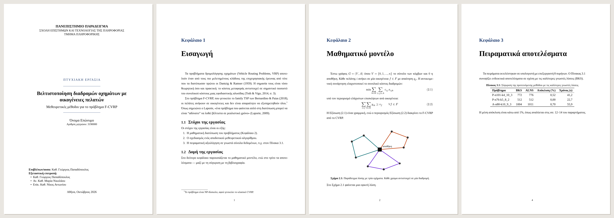
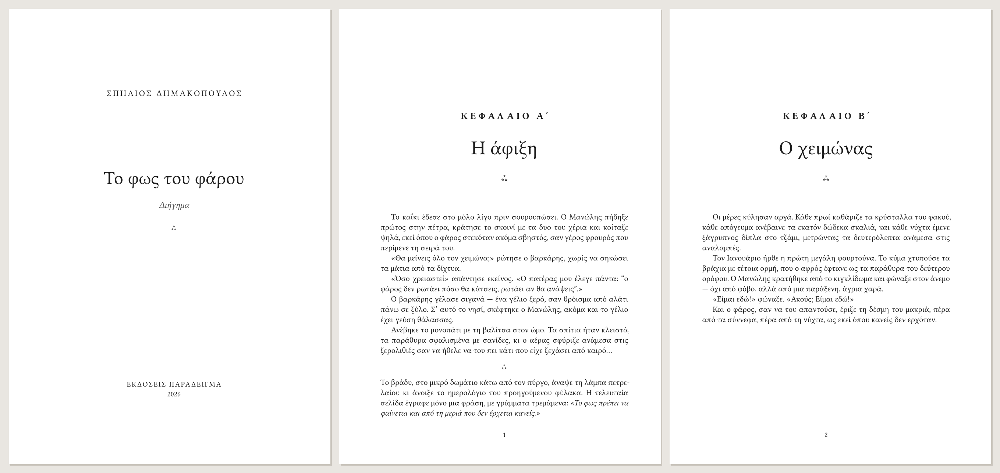

<div align="center">

# greekbook

**Write in Markdown. Get a properly typeset Greek book or thesis.**
<br>PDF, PDF/A and EPUB, without LaTeX and without fighting Word.

[](https://github.com/SpiliosDimakopoulos/greekbook/actions/workflows/ci.yml)


[Ελληνικά](README.el.md) · [Quick start](#quick-start) · [Writing](#writing) · [Templates](#templates) · [Greek typography](#greek-typography)



</div>

Greek text has rules that general-purpose tools get wrong. Word justifies Greek
with rivers of white space because it does not hyphenate it. LaTeX does it right,
but `polyglossia`, `fontspec` and `biblatex` are a steep climb for a student
with a deadline. **greekbook** sits in between: you write plain Markdown, and it
produces a book or thesis set with a modern typesetting engine
([Typst](https://typst.app)) and with the Greek-specific rules built in.

```console
$ pip install git+https://github.com/SpiliosDimakopoulos/greekbook
$ greekbook new my-thesis --template thesis
$ greekbook build my-thesis --pdfa
✓ PDF: my-thesis/thesis.pdf  (0.4s)
```

## What you get

- **Theses that pass the checklist.** University cover page, declaration of
  originality, Greek and English abstracts, table of contents, lists of
  figures and tables, Roman-numbered front matter, per-chapter numbering
  (Σχήμα 2.1, Πίνακας 3.1, (2.4)), appendices lettered Α, Β, Γ, and **PDF/A-2b**
  output for institutional repositories.
- **Citations** from a `.bib` file in APA, IEEE, Harvard, Chicago, MLA,
  Vancouver or any CSL style: `[@knuth1984, σ. 12]`.
- **Math in LaTeX syntax** (`$\frac{a}{b}$`), the notation students already know,
  rendered natively by Typst through a bundled [mitex](https://github.com/mitex-rs/mitex).
- **Books and e-books.** Literary templates with running heads, scene breaks,
  chapter numbers in Greek numerals (ΚΕΦΑΛΑΙΟ Α΄), title, copyright and dedication
  pages, plus EPUB 3 with soft hyphens for e-readers that cannot hyphenate Greek.
- **A linter for invisible mistakes**: Latin letters hiding inside Greek words,
  a medial ς, unpaired quotes, citations missing from the bibliography,
  references to labels that don't exist, missing images.
- **Fast and self-contained**: one `pip install`, no TeX distribution, fonts
  bundled, rebuilds in under a second, works offline.

## Quick start

```console
$ greekbook new my-novel --template novel     # or: thesis
$ cd my-novel
$ greekbook watch                             # rebuilds the PDF on every save
```

A project is a folder:

```
my-thesis/
├── book.yaml              # title, author, template, university details
├── front/abstract.md      # front matter (unnumbered, Roman page numbers)
├── chapters/
│   ├── 01-eisagogi.md     # chapters, in filename order
│   └── 02-methodologia.md
├── appendix.md
├── figures/
└── references.bib
```

| Command | What it does |
|---|---|
| `greekbook new DIR -t thesis\|novel` | Start a project from a working example |
| `greekbook build [DIR] [--epub] [--pdfa] [--open]` | Build the PDF (and EPUB) |
| `greekbook watch [DIR]` | Rebuild on every change |
| `greekbook validate [DIR] [--strict]` | Check text, citations, references and images |
| `greekbook doctor` | Check the installation |
| `greekbook templates` | List the templates |

## Writing

Standard Markdown, plus the Pandoc conventions people already use for papers:

| You write | You get |
|---|---|
| `"text"` | «text», nested quotes become «… “…” …» |
| `---` / `--` / `...` | em dash —, en dash –, ellipsis … |
| `# Εισαγωγή {#sec:intro}` | a chapter you can reference with `@sec:intro` |
| `# Παράρτημα {-}` | an unnumbered heading |
| `# Μέρος πρώτο {.part}` | a part divider page (ΜΕΡΟΣ ΠΡΩΤΟ) |
| `{#fig:map width=70%}` | numbered figure, `@fig:map` → «Σχήμα 2.1» |
| a table followed by `Table: Λεζάντα {#tbl:res}` | numbered table with caption |
| `$$ E = mc^2 $$ (eq:e)` | numbered equation, `@eq:e` → «Εξίσωση (2.1)» |
| `[@knuth1984, σ. 12]`, `[@a; @b]`, `@knuth1984` | citations: parenthetical, grouped, in prose |
| `στον Πίνακα [-@tbl:res]` | the number only, so you can decline the noun yourself |
| `Κείμενο[^1]` / `^[inline note]` | footnotes |
| `---` between paragraphs | a scene break ⁂ |
| `\newpage` | a page break |

<details>
<summary><b>book.yaml reference</b></summary>

```yaml
title: Βελτιστοποίηση διαδρομών οχημάτων
subtitle: Μεθευρετικές μέθοδοι
author: Όνομα Επώνυμο
template: thesis            # novel | classic | sepia | clean | academic | thesis
language: el                # el | en
page_size: A4               # A4, A5, B5, 6x9in, 148x210mm, …
front_matter: [front/abstract.md, front/abstract-en.md]
chapters: [chapters/01.md]  # optional; default: every chapters/*.md
appendices: [appendix.md]
bibliography: references.bib
citation_style: apa         # apa | ieee | harvard | chicago | chicago-notes | mla | vancouver | file.csl
toc: true
list_of_figures: true
list_of_tables: true
chapter_numbering: auto     # auto | greek (Α΄) | arabic | roman | words (Πρώτο) | none
math: latex                 # latex | typst
pdf_standard: a-2b          # 1.7 | a-2b | a-3b | ua-1
font: Libertinus Serif      # any installed or bundled font
font_size: 11pt
thesis:
  type: Διπλωματική Εργασία
  institution: …
  school: …
  department: …
  program: …
  student_id: "…"
  supervisor: …
  committee: [ … ]
  place: Αθήνα
  date: Ιούνιος 2026
  logo: figures/logo.png
  declaration: true
# books
publisher: …
year: "2026"
copyright: © 2026 …
dedication: …
epigraph: …
```

Unknown keys are rejected with a message that lists the valid ones, so typos
never fail silently.
</details>

## Templates



| Template | For | Look |
|---|---|---|
| `thesis` | Bachelor/master theses | Liberation Serif (Times-compatible) 12 pt, 1.5 spacing, binding margin, cover page |
| `academic` | Papers, lecture notes | Computer Modern, numbered sections |
| `novel` | Fiction | Libertinus Serif, Greek-numeral chapters, centred running heads |
| `classic` | Fiction | Computer Modern, «Κεφάλαιο Πρώτο», chapters open on a right-hand page |
| `sepia` | Fiction on screen | warm paper colour and ink |
| `clean` | Guides, manuals | sans-serif, large chapter numbers |

## Greek typography

What greekbook does that generic tools don't:

- **Hyphenation and justification.** The PDF uses Typst's TeX-quality line breaking
  with Greek hyphenation patterns. Titles and headings are never hyphenated.
- **Quotes by nesting level.** «…» outside, “…” inside, as Greek typesetting
  requires. Quotes you typed yourself count towards the nesting.
- **Capitals without accents.** Running heads, chapter labels and covers are
  set in capitals the Greek way: accents are dropped, and an accent that kept
  two vowels apart becomes a diaeresis (τσάι → ΤΣΑΪ, ρολόι → ΡΟΛΟΪ, άυλος → ΑΫΛΟΣ).
  Typst's own `upper()` and CSS `text-transform` keep the accents.
- **Greek numerals** for chapters and parts (Α΄, Β΄, … ΙΑ΄, ΙΣΤ΄).
- **No-break spaces** after reference abbreviations (σ. 12, σσ. 4–7, κεφ. 3).
- **Grammatical case in cross-references.** Greek declines nouns, so the generic
  «στον Πίνακας 3.1» is wrong. Write `στον Πίνακα [-@tbl:x]` to get only the number.
- **Syllabification for EPUB.** E-readers often have no Greek hyphenation, so
  greekbook inserts soft hyphens with its own syllabifier. It follows the school
  grammar's rules and gets **100 % of an 85-word gold list right**
  (see [`tests/test_hyphenation.py`](tests/test_hyphenation.py)).

## How it works

```
Markdown + book.yaml + .bib
   │  markdown-it-py (CommonMark + footnotes, tables, math, attributes)
   ▼
syntax tree ──► Greek typography (quotes, dashes, spacing) ──► escaping
   │
   ├──► Typst markup + greekbook Typst templates ──► Typst ──► PDF / PDF/A
   └──► XHTML + soft hyphens ──► EPUB 3
```

The Typst templates live in a regular Typst package
(`src/greekbook/typst/packages/local/greekbook`), so you can also use them by hand
or keep the generated source (`greekbook build --keep-typst`) and keep editing in Typst.

## Development

```console
$ git clone https://github.com/SpiliosDimakopoulos/greekbook && cd greekbook
$ pip install -e ".[dev]"
$ pytest            # 150+ tests: unit, end-to-end PDF checks, hypothesis properties
$ ruff check src tests && mypy
```

CI runs the suite on Linux, macOS and Windows with Python 3.10–3.13, builds both
sample projects, validates the EPUB with epubcheck and publishes the PDFs as artifacts.
Contributions, especially university cover pages and typographic rules, are welcome:
see [CONTRIBUTING.md](CONTRIBUTING.md).

## License

Code: see [LICENSE](LICENSE). Bundled fonts: SIL Open Font License / Bitstream Vera
(see `src/greekbook/fonts`). Bundled mitex: Apache-2.0.
