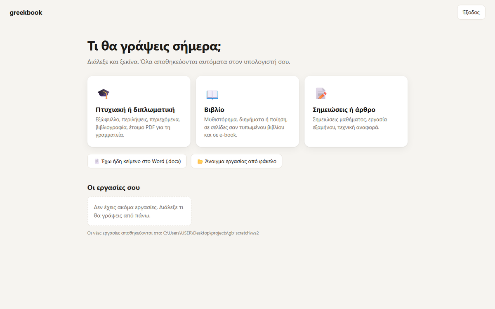
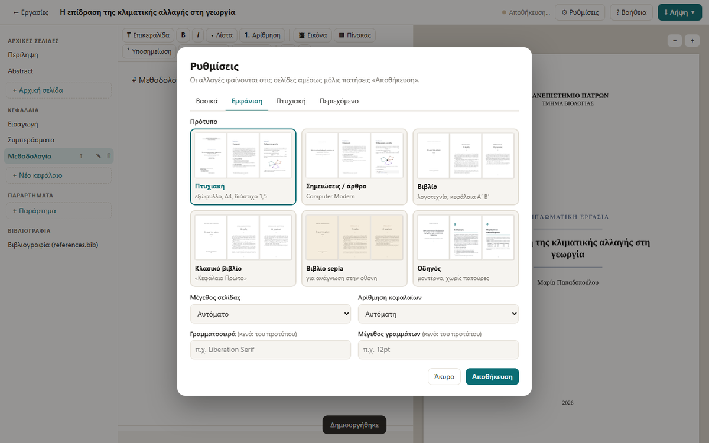
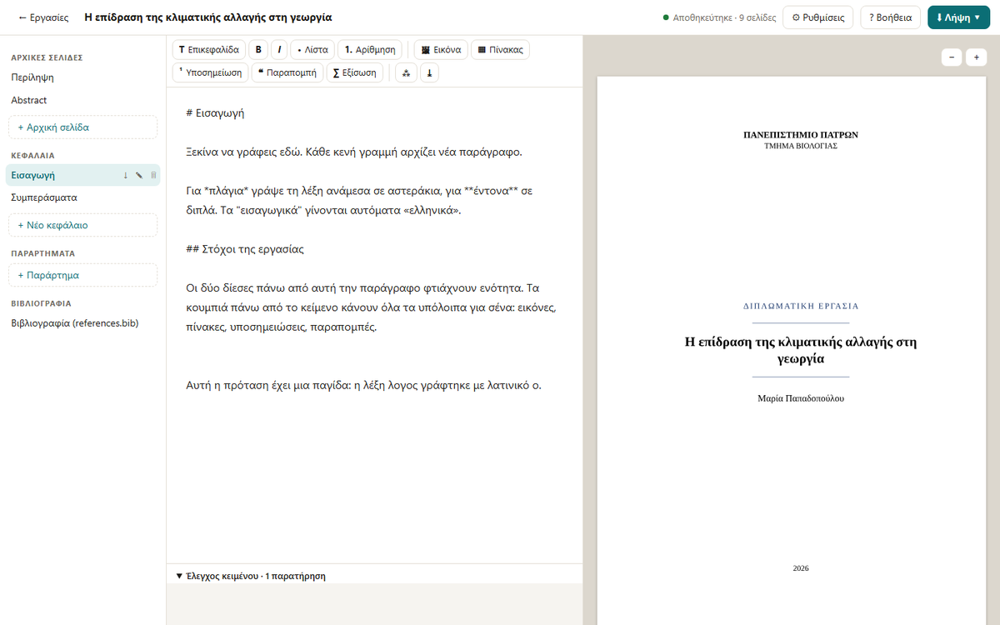

# Για όλους, χωρίς προγραμματισμό

Δεν χρειάζεται να ξέρεις τίποτα από υπολογιστές πέρα από το να κατεβάζεις ένα αρχείο.
Δεν χρειάζεται Python, ούτε τερματικό, ούτε εγκατάσταση.

## 1. Κατέβασε την εφαρμογή

[⬇ Windows](https://github.com/SpiliosDimakopoulos/greekbook/releases/latest/download/greekbook-windows.exe){ .md-button .md-button--primary }
[⬇ Mac](https://github.com/SpiliosDimakopoulos/greekbook/releases/latest/download/greekbook-macos.zip){ .md-button }

Είναι ένα μόνο αρχείο (περίπου 50 MB). Βάλ' το όπου θέλεις, π.χ. στην Επιφάνεια εργασίας.

## 2. Άνοιξέ την με διπλό κλικ

Ανοίγει ένα μικρό μαύρο παράθυρο και αμέσως μετά ο browser σου με την εφαρμογή.
**Άφησε το μαύρο παράθυρο ανοιχτό όσο γράφεις.** Όταν τελειώσεις, πάτα «Έξοδος».

!!! warning "Η πρώτη φορά στα Windows"
    Τα Windows μπορεί να δείξουν «Τα Windows προστάτευσαν τον υπολογιστή σας».
    Αυτό εμφανίζεται για κάθε νέο πρόγραμμα που δεν έχει αγοράσει ψηφιακή υπογραφή από
    εταιρεία· δεν σημαίνει ότι κάτι είναι λάθος. Πάτα **«Περισσότερες πληροφορίες» →
    «Εκτέλεση ούτως ή άλλως»**. Ο κώδικας είναι ανοιχτός και μπορεί να τον ελέγξει όποιος θέλει.

!!! warning "Η πρώτη φορά σε Mac"
    Άνοιξε το zip. Μετά κάνε **δεξί κλικ στο «greekbook» → «Άνοιγμα» → «Άνοιγμα»**.
    (Με απλό διπλό κλικ το macOS λέει ότι δεν μπορεί να ελέγξει τον δημιουργό.)
    Από τη δεύτερη φορά ανοίγει κανονικά.

## 3. Διάλεξε τι θα γράψεις

Πάτα «Πτυχιακή ή διπλωματική», γράψε τον τίτλο, το όνομά σου και το πανεπιστήμιο, και
πάτα «Δημιουργία». Αν έχεις ήδη κείμενο στο Word, πάτα **«Έχω ήδη κείμενο στο Word»**:
τα κεφάλαια χωρίζονται μόνα τους.

## 4. Γράψε

- **Αριστερά** είναι τα κεφάλαια. «+ Νέο κεφάλαιο» για καινούργιο, ↑↓ για αλλαγή σειράς,
  ✎ για μετονομασία.
- **Στη μέση** γράφεις. Μια κενή γραμμή κάνει νέα παράγραφο. Όλα αποθηκεύονται μόνα τους.
- **Δεξιά** βλέπεις τις σελίδες όπως θα τυπωθούν.
- Τα **κουμπιά πάνω από το κείμενο** βάζουν επικεφαλίδα, λίστα, εικόνα, πίνακα,
  υποσημείωση, παραπομπή. Μια εικόνα μπορείς και να τη **σύρεις** μέσα στο κείμενο ή να
  την **επικολλήσεις** (Ctrl+V).
- Το κουμπί **«? Βοήθεια»** δείχνει όλα τα κόλπα σε μια σελίδα.

## 5. Ρυθμίσεις

Από το **«⚙ Ρυθμίσεις»** αλλάζεις τίτλο, εμφάνιση (με μικρογραφίες για να δεις πώς θα
είναι), τα στοιχεία του εξωφύλλου (πανεπιστήμιο, επιβλέπων, επιτροπή, λογότυπο) και τι θα
περιέχει (πίνακας περιεχομένων, κατάλογοι, PDF/A για το αποθετήριο).

## 6. Έλεγχος και παράδοση

Κάτω από το κείμενο, ο **«Έλεγχος κειμένου»** βρίσκει λάθη που δεν φαίνονται με το μάτι:
λατινικά γράμματα μέσα σε ελληνικές λέξεις (με κουμπί «Διόρθωση»), «ς» στη μέση λέξης,
μονά εισαγωγικά, παραπομπές σε πηγές που δεν υπάρχουν.

Όταν τελειώσεις: **«⬇ Λήψη» → PDF**. Για Kindle και κινητά: **EPUB**.

## Πού είναι τα αρχεία μου;

Στον φάκελο **Έγγραφα → greekbook**, ένας φάκελος για κάθε εργασία. Το PDF αποθηκεύεται
κι εκεί αυτόματα. Κάνε αντίγραφο ασφαλείας αυτόν τον φάκελο (π.χ. σε Google Drive ή
OneDrive). Ό,τι διαγράφεις από την εφαρμογή πηγαίνει στον υποφάκελο «.kados», δεν χάνεται.
