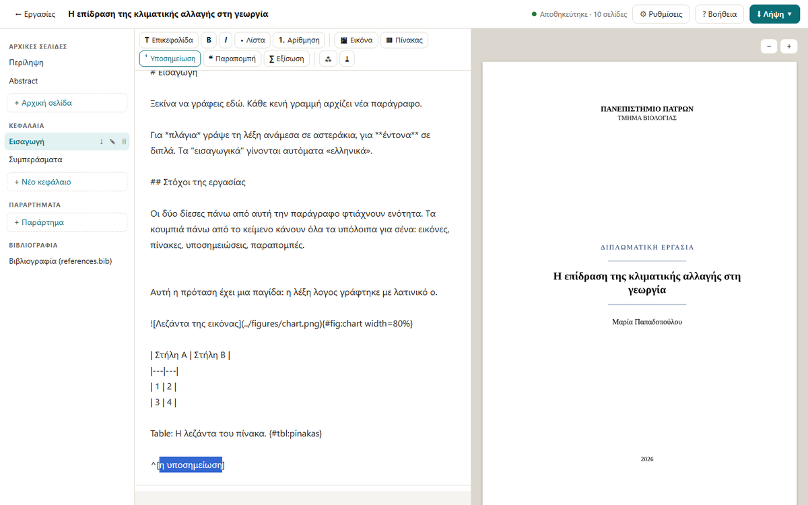

---
hide:
  - navigation
---

# greekbook

**Γράφεις σε Markdown. Παίρνεις σωστά στοιχειοθετημένο ελληνικό βιβλίο ή πτυχιακή.**
PDF, PDF/A και EPUB, χωρίς LaTeX και χωρίς μάχες με το Word.

[⬇ Κατέβασε την εφαρμογή](gia-olous.md){ .md-button .md-button--primary }
[Δοκίμασέ το στον browser](demo/){ .md-button }


## Γιατί

Το Word στοιχίζει τα ελληνικά με μεγάλα κενά, επειδή δεν τα συλλαβίζει, και κάθε
αλλαγή στη μορφή σπάει την αρίθμηση. Το LaTeX τα κάνει σωστά, αλλά θέλει εβδομάδες
εξοικείωσης με `polyglossia`, `fontspec` και `biblatex`. Το greekbook είναι η μέση λύση.
Γράφεις απλό κείμενο σε Markdown και η στοιχειοθεσία γίνεται με τη σύγχρονη μηχανή
[Typst](https://typst.app), με τους κανόνες της ελληνικής τυπογραφίας ενσωματωμένους.

<div class="grid cards" markdown>

-   **Πτυχιακές που περνούν τον έλεγχο**

    Εξώφυλλο, δήλωση πρωτοτυπίας, περιλήψεις, κατάλογοι, αρίθμηση ανά κεφάλαιο,
    παραρτήματα και PDF/A για τα ιδρυματικά αποθετήρια.

-   **Βιβλιογραφία και μαθηματικά**

    Παραπομπές από `.bib` (Zotero, Mendeley) σε APA, IEEE, Harvard και άλλα στυλ.
    Μαθηματικά σε σύνταξη LaTeX.

-   **Ελληνική τυπογραφία**

    Συλλαβισμός, «εισαγωγικά “μέσα” σε εισαγωγικά», κεφαλαία χωρίς τόνους (ΤΣΑΪ),
    ελληνική αρίθμηση (Α΄, Β΄) και σωστή πτώση στις παραπομπές.

-   **Εργαλεία**

    Ζωντανή προεπισκόπηση, εισαγωγή από Word, έλεγχος για «αόρατα» λάθη και EPUB
    για e-readers.

</div>

## Δύο τρόποι να ξεκινήσεις

**Χωρίς προγραμματισμό:** [κατέβασε την εφαρμογή](gia-olous.md) για Windows ή Mac και
άνοιξέ τη με διπλό κλικ.



**Με Python:**

```console
$ pip install greekbook
$ greekbook
```

Το σκέτο `greekbook` ανοίγει ένα μενού με επιλογές, χωρίς εντολές για απομνημόνευση.
