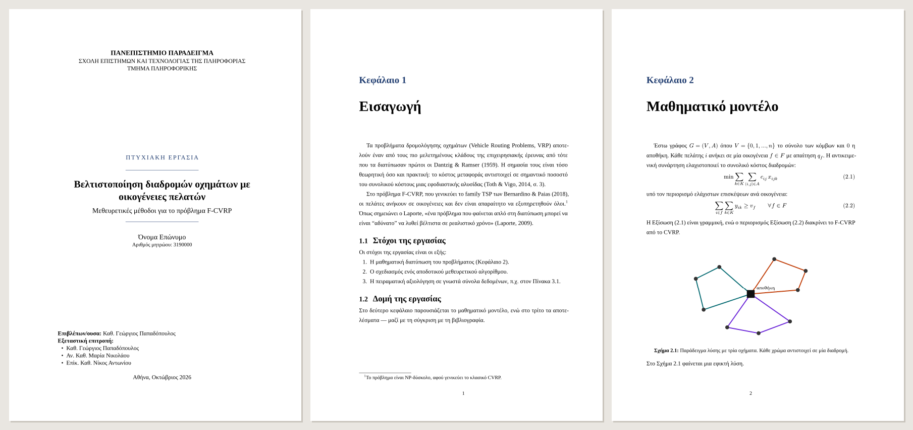
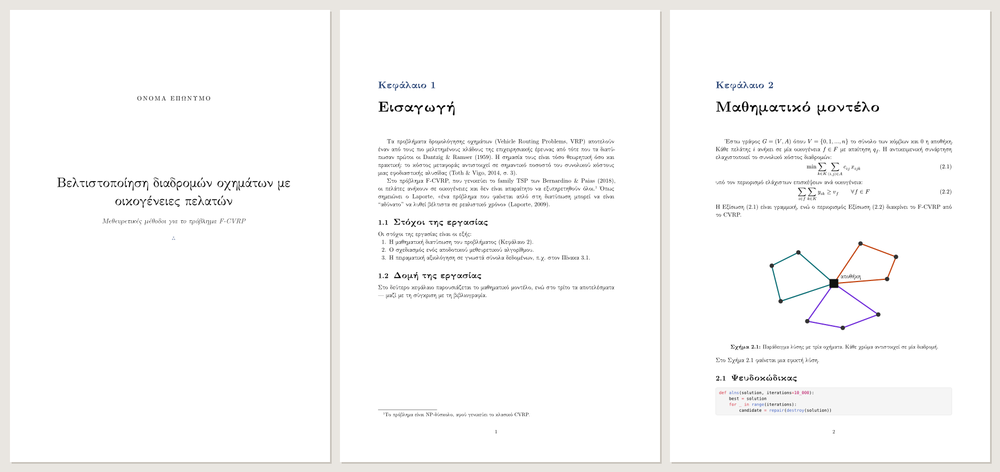
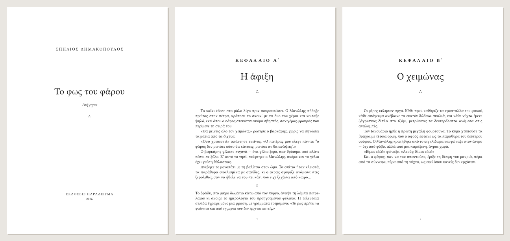
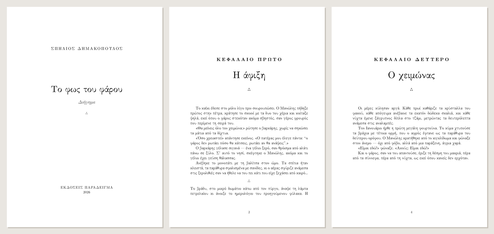
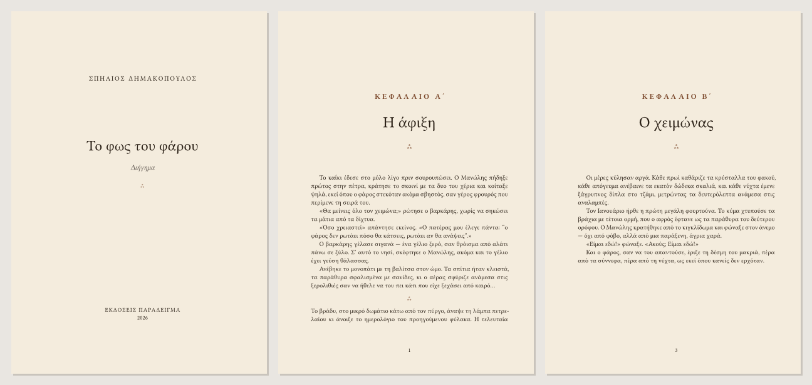
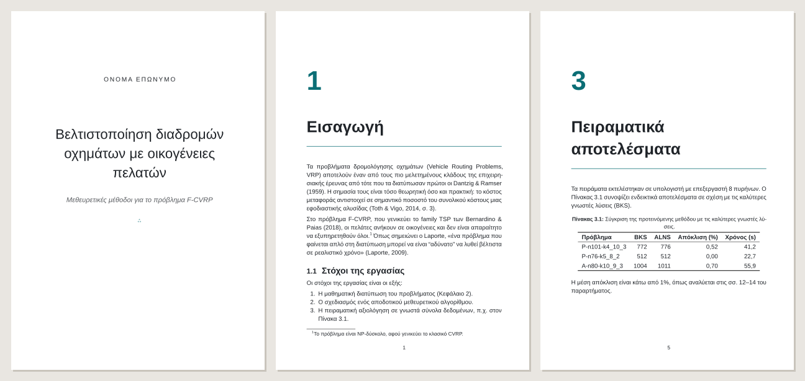

# Πρότυπα

Αλλάζεις πρότυπο με μία γραμμή στο `book.yaml` (`template: classic`) χωρίς να
αγγίξεις το κείμενο. Δοκίμασέ τα όλα στο [demo](demo/).

## thesis

Πτυχιακές και διπλωματικές: Times-συμβατή γραμματοσειρά 12 pt, διάστιχο 1,5,
περιθώριο βιβλιοδεσίας, εξώφυλλο με τα στοιχεία του ιδρύματος.

## academic

Άρθρα, σημειώσεις μαθημάτων και τεχνικές αναφορές σε Computer Modern.

## novel

Λογοτεχνία: Libertinus Serif, κεφάλαια με ελληνική αρίθμηση, κεφαλίδες με το όνομα του
συγγραφέα και τον τίτλο του κεφαλαίου.

## classic

Κλασικό βιβλίο: Computer Modern, «ΚΕΦΑΛΑΙΟ ΠΡΩΤΟ», τα κεφάλαια ανοίγουν σε δεξιά σελίδα.

## sepia

Για ανάγνωση στην οθόνη: ζεστό χρώμα χαρτιού και μελανιού.

## clean

Μοντέρνο sans-serif για οδηγούς, εγχειρίδια και τεκμηρίωση.

## Δικό σου πρότυπο

Τα πρότυπα είναι ένα κανονικό πακέτο Typst
([`lib.typ`](https://github.com/SpiliosDimakopoulos/greekbook/tree/main/src/greekbook/typst/packages/local/greekbook)).
Με `greekbook build --keep-typst` κρατάς το παραγόμενο `.typ` και συνεχίζεις μόνος
σου στο Typst όπου θέλεις πλήρη έλεγχο.
