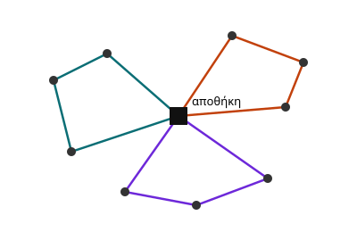

# Μαθηματικό μοντέλο {#sec:model}

Έστω γράφος $G = (V, A)$ όπου $V = \{0, 1, \dots, n\}$ το σύνολο των κόμβων και $0$ η αποθήκη. Κάθε πελάτης $i$ ανήκει σε μία οικογένεια $f \in F$ με απαίτηση $q_f$. Η αντικειμενική συνάρτηση ελαχιστοποιεί το συνολικό κόστος διαδρομών:

$$\min \sum_{k \in K} \sum_{(i,j) \in A} c_{ij} \, x_{ijk}$$ (eq:objective)

υπό τον περιορισμό ελάχιστων επισκέψεων ανά οικογένεια:

$$\sum_{i \in f} \sum_{k \in K} y_{ik} \geq v_f \qquad \forall f \in F$$ (eq:family)

Η @eq:objective είναι γραμμική, ενώ ο περιορισμός @eq:family διακρίνει το F-CVRP από το CVRP.

{#fig:routes width=75%}

Στο @fig:routes φαίνεται μια εφικτή λύση.

## Ψευδοκώδικας

```python
def alns(solution, iterations=10_000):
    best = solution
    for _ in range(iterations):
        candidate = repair(destroy(solution))
        if accept(candidate, solution):
            solution = candidate
    return best
```
